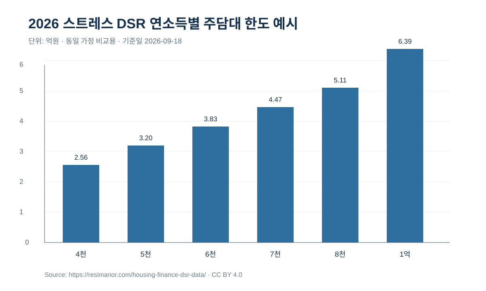

# Embed & reuse

Resimanor의 공개 차트와 데이터를 기사·블로그·가이드에 사용할 수 있습니다. 자료의 원문과 계산 기준일을 함께 확인하세요. 검색 순위용 백링크는 필수가 아니며 링크 속성은 게시자가 선택합니다.

## Chart embed

### Markdown

```markdown
[](https://resimanor.com/housing-finance-dsr-data/)
```

### HTML

```html
<a href="https://resimanor.com/housing-finance-dsr-data/" target="_blank" rel="noopener">
  
</a>
<p>자료: <a href="https://resimanor.com/housing-finance-dsr-data/">Resimanor 2026 주택금융·DSR 데이터센터</a></p>
```

## One-line source link

### HTML

```html
<p>출처: <a href="https://resimanor.com/housing-finance-dsr-data/" target="_blank" rel="noopener">Resimanor 스트레스 DSR 데이터센터</a></p>
```

### Markdown

```markdown
출처: [Resimanor 스트레스 DSR 데이터센터](https://resimanor.com/housing-finance-dsr-data/)
```

## Suggested reuse blocks

### DSR 데이터센터 링크

```html
<a href="https://resimanor.com/housing-finance-dsr-data/" target="_blank" rel="noopener">2026 스트레스 DSR 데이터센터</a>
```

## CSV links

- 연소득별 한도: https://raw.githubusercontent.com/cheer710815-hub/resimanor-housing-finance-data/main/income_mortgage_limits.csv
- 신용대출 잔액별 한도: https://raw.githubusercontent.com/cheer710815-hub/resimanor-housing-finance-data/main/credit_debt_mortgage_limits.csv

## License

명시적으로 CC BY 4.0이 적용된 자료는 해당 라이선스의 저작자 표시·라이선스 링크·변경 고지 조건을 지켜주세요. 검색 순위용 백링크나 특정 rel 속성은 요구하지 않습니다. 제3자 자료는 제공처 이용조건을 따릅니다.


## Interactive widget

스트레스 DSR 한도 가상 예시 위젯을 외부 사이트에 삽입할 수 있습니다. 링크는 자동으로 표시되지 않으며, 출처 링크 표시를 원하면 컨테이너에 `data-show-source="true"`를 추가하세요. 두 개 이상의 위젯도 독립적으로 동작하도록 수정했습니다. 계산 데이터는 기존 2026년 시나리오를 유지하며 금융기관 승인한도나 최신 규제 적합성 판정을 제공하지 않습니다.

### HTML embed

```html
<div data-resimanor-dsr-widget></div>
<script src="https://cdn.jsdelivr.net/gh/cheer710815-hub/resimanor-housing-finance-data@2f2a30ca1124853c0af9cff054bdddecd3794ed2/widgets/resimanor-dsr-widget.js"></script>
```

### Widget source

- https://github.com/cheer710815-hub/resimanor-housing-finance-data/blob/main/widgets/resimanor-dsr-widget.js

### Canonical source

- https://resimanor.com/housing-finance-dsr-data/
